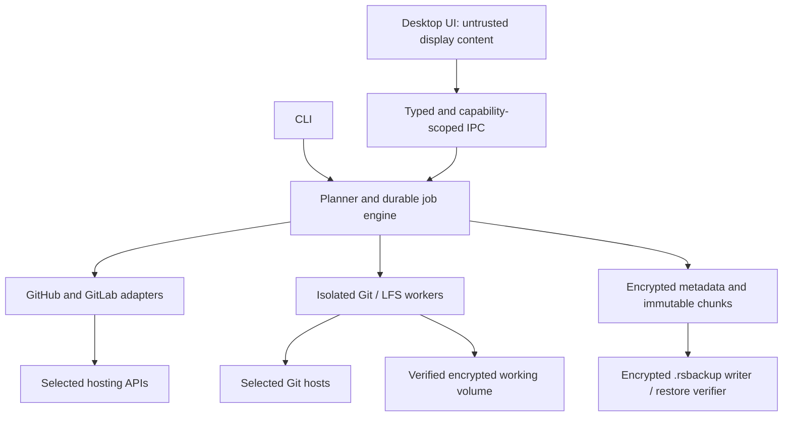

# Architecture

Design proposal, 2026-11-08. Implemented components are explicitly marked below.

## Recommended stack

| Concern | Choice | Reason and trade-off |
| --- | --- | --- |
| Core and CLI | Rust workspace | Shared engine, native binaries, bounded memory; more learning/build effort than extending Python. |
| Desktop | Tauri 2 | Linux/Windows packaging and small shell using system webviews; Linux WebKitGTK and Windows WebView2 need explicit testing. |
| UI | React + TypeScript + Vite | Implemented with bounded status polling and paginated catalog queries; no SSR/server. Query libraries and virtualized provider/bulk lists remain future options. |
| Concurrency | Serialized Rust background worker now; bounded async provider queues later | Desktop operations run off the UI thread and serialize vault access; future network workers need separate limits. |
| Git transport | Native Git + Git LFS, isolated child processes | Broad compatibility, mature pack negotiation and SSH; signed/versioned sidecars and licenses become release responsibilities. Evaluate libgit2/gix only if benchmarks justify replacing Git. |
| Provider APIs | reqwest + serde, explicit GitHub/GitLab adapters | Versioned capability negotiation for cloud and user-entered self-hosted endpoints. |
| Metadata | Encrypted JSON catalog now; indexed database later | 8 MiB bounded snapshot, atomically replaced under a lock; indexed queries can justify SQLCipher later. |
| Vault and backup crypto | age 0.11.5, X25519 identity, age scrypt key envelope | Authenticated streaming via a maintained portable library; the application format remains experimental. |
| Diagnostics | structured events, redaction, local encrypted history | Useful support data without copying tokens or raw provider responses into logs. |
| Distribution | Native Linux and Windows CI builds | Produce and install-test the requested package formats on their own OS. |

These choices are recommendations, not benchmark claims. Tauri packaging documentation lists the requested formats: <https://v2.tauri.app/distribute/>. Pin dependencies and commit lockfiles when introduced; avoid invented/latest version guesses in the design.

## Module boundaries

Core owns validation, plans, conflict rules and job state. Providers own API paging, capabilities and field translation. Git worker owns object transfer and verification. Vault owns keys and persistence. Desktop owns presentation; vault identities stay in Rust, passphrases cross typed local IPC transiently, and the renderer cannot run arbitrary shell commands.

**Implemented:** `repo-stealer-core` parses/compares heads and tags; `repo-stealer-vault` stores an encrypted catalog and immutable streamed objects, verifies and restores same-key backups; `repo-stealer-cli` exposes these operations. `repo-stealer-git` adds verified encrypted workspaces and local Git snapshot capture/restore. `repo-stealer-app` provides the shared desktop service, bounded catalog/status APIs and session jobs; `apps/desktop` contains the Tauri 2 shell and React renderer. Provider/remote-transfer modules remain planned. See [actual and proposed flow](FLOW.md).

## Persistence and job model

Future indexed schema (not implemented): instances, accounts, repositories, jobs, steps, snapshots, entities, entity_mappings, checkpoints, audit_events, blob_manifests. Composite identity is `(provider, instance UUID, repository remote ID, entity kind, remote ID)`; repository names and issue numbers are not globally unique. A source entity maps to one destination entity per migration lineage. Unique constraints and persisted intent/result records reduce duplicates; API writes with ambiguous outcomes require reconciliation, never blind replay.

Immutable encrypted blobs hold Git bundles/pack snapshots, LFS content, attachments and raw provider evidence. Encrypt names and manifests too; deduplication stays inside one vault, avoiding cross-user content correlation. Database references become visible only after blob write + authentication + atomic publication. Orphan cleanup must never delete a committed snapshot. One vault writer lease prevents concurrent writers; queries may read concurrently.

State machine: `draft -> preflight -> planned -> acquiring -> captured -> applying -> verifying -> completed|completed_with_gaps`, with `paused|failed|cancelled|needs_reconciliation` transitions. Each completed step records input snapshot identity and output verification. A restart reconciles in-flight remote writes before retrying. Source mutation during capture is detected by ref/entity inventory rechecks; a changing remote is not an atomic snapshot and must be reported.

## Throughput

Start with 2 Git transfers globally and 4 API requests per host, configurable downwards and increased only from measurements. Separate disk/crypto pools prevent network fan-out from exhausting RAM. Respect provider rate/reset/retry headers, jitter retries for transient reads, cap attempts and bytes, and persist page cursors. Use incremental fetch, conditional API requests where available, batched queries and chunked attachment I/O. Git packs are already compressed: do not spend CPU recompressing them by default.

Performance targets to validate: UI stays interactive during transfers; no work proportional to entire repository size in RAM; bounded live transfer buffers; cancellation stops child process trees; restart resumes at verified step boundaries (not an unsupported promise of byte-resuming every Git clone). Benchmark small-repository batches, a large Git/LFS repository, and metadata-heavy projects against the old five-worker scripts on the same machine/network. Report wall time, bytes, peak RSS, CPU, retries and encryption cost. No speed multiplier is claimed before this exists.

## Storage implementation

Current vault layout is `lock` plus `data/vault.key`, `data/catalog.age`, and `data/objects/<random-id>.age`. Names, sizes and hashes reside inside the encrypted catalog; object plaintext binds its random ID and is checked against catalog size/SHA-256. fs2 exclusive locks serialize operations. age handles recipient/file keys, authenticated chunk ordering and stream finalization. See SECURITY.md for exact limits and publication semantics.

Local Git snapshot implementation uses installed Git 2.48+, reftable, isolated config/process groups and strict full-history bundles. Linux accepts ext4/XFS on LUKS; Windows creates/verifies EFS directories. See [Git snapshots](GIT-SNAPSHOTS.md). New dependencies are process-wrap (Unix groups/Windows jobs), ctrlc (CLI cancellation), libc (Linux filesystem/device/atomic rename APIs) and windows-sys (Windows EFS/attribute/atomic rename APIs); locked versions and crate sources are in Cargo.lock.

## Desktop implementation

The native shell is a standalone Cargo workspace so CLI development does not depend on WebKitGTK. The renderer receives summaries, up to 100 requested catalog entries and 20 session jobs. The application service owns the unlocked Vault and a single background operation; Git progress uses fixed phase callbacks and cancellation flags. Session history is not durable or resumable. No provider credentials or connection UI are implemented. Native source and installed-package tests are separate release gates. See [desktop usage and boundaries](DESKTOP.md).
