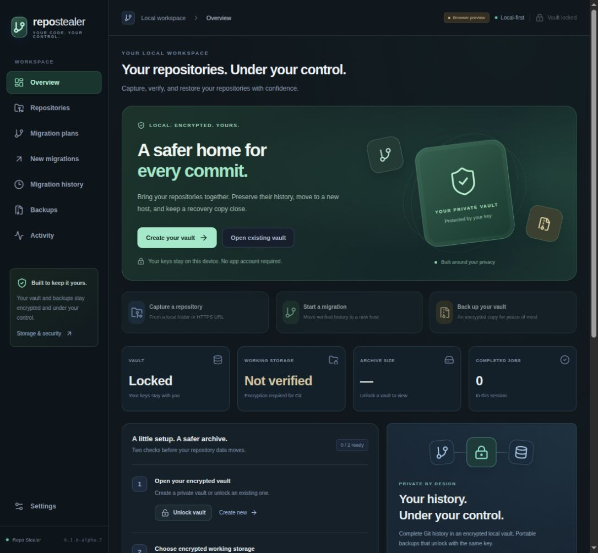
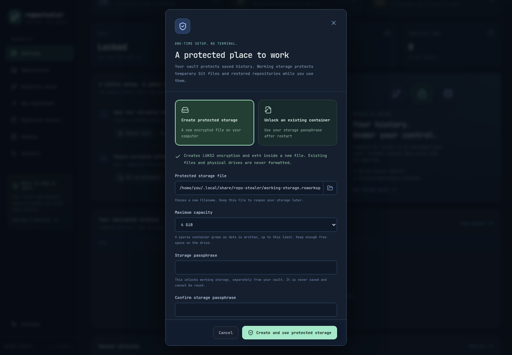

# Desktop application

Alpha.6 adds [encrypted LFS payload capture, offline restore and guarded migration](GIT-LFS.md). Capture remains Git-only unless explicitly enabled. LFS manifest v3 requires alpha.6; older snapshot and same-key backup formats remain readable.

The Tauri 2/React desktop exposes encrypted vaults, local/HTTPS Git and optional LFS capture, offline restore, same-key portable backups, read-only destination plans and guarded new-private personal migration for GitHub/GitLab cloud/self-hosted instances. Existing destinations cannot be adopted. [Alpha.6 installers](https://github.com/hrishi072/repo-stealer/releases/tag/v0.1.0-alpha.6) were published after the [complete signed-tag workflow](https://github.com/hrishi072/repo-stealer/actions/runs/43170426846) passed native Linux/Windows LFS migration/recovery/privacy, DEB/NSIS install/launch and extracted AppImage checks. Desktop RPM packaging/identity/digest checks passed; RPM installation on Fedora/openSUSE remains untested.



## Use the application

Create a new vault or unlock an existing CLI vault using its path and passphrase. Choose **Set up workspace**. On Linux, create a new encrypted container file or unlock an existing one; on Windows, create the EFS working folder with one click. The advanced option accepts a folder on existing verified encrypted storage. Git 2.48+ must be installed and available in PATH.

Capture a local ordinary/bare repository under a unique snapshot name. Restore creates a new bare repository directly inside the verified workspace; existing destinations are never replaced. All reachable Git history, refs and HEAD are preserved. Check Include Git LFS payloads to archive all supported historical payloads; restore automatically verifies and reinstalls them offline. Uncommitted files, unreachable history, external submodule repositories and hosting metadata are excluded. See [Git fidelity and platform requirements](GIT-SNAPSHOTS.md).

Backups can be created, verified and restored from the Backups page. Recovery requires the original vault passphrase and a new destination, and restores the same wrapped vault identity. Lock the current vault before restoring another. There is no password reset. Operations never overwrite existing backup/vault paths.

Jobs execute outside the renderer thread and show real phases, with cancellation for Git operations. A forced close has the same encrypted staging boundary as the CLI; jobs are not resumable. Activity, chosen paths and workspace selection are session-only, so reopening requires selecting them again. Lock clears catalog results and releases the vault identity; the generic session activity list remains visible, while remote origin/inventory reports are cleared. No hosting credentials, telemetry or preferences are persisted.

## Build and run

Install Rust 1.88+, Node 24, and the [Tauri platform prerequisites](https://v2.tauri.app/start/prerequisites/). Linux needs a writable tmpfs mount at `/dev/shm` for its private browser profile, plus WebKitGTK 4.1 and GTK3 development libraries; Windows needs MSVC build tools and WebView2. Platform dependencies are needed for the native shell, not the root CLI workspace.

```sh
npm --prefix apps/desktop ci
npm --prefix apps/desktop run tauri dev
```

From `apps/desktop`, run `npm run tauri build -- --bundles deb,appimage -- --locked` on Linux or `npm run tauri build -- --bundles nsis -- --locked` on Windows. Then run `python scripts/package_desktop.py` from the repository root to name release assets; Linux also requires `rpmbuild` and `desktop-file-validate`. This creates an RPM with the SemVer prerelease mapped into its Release field, avoiding Tauri’s current RPM hyphen rejection. Build output is inside `apps/desktop/src-tauri/target/release/bundle`. Desktop installers are named separately from CLI packages in releases. Windows binaries are not Authenticode signed. Only x86_64 is currently packaged.

`npm --prefix apps/desktop run dev` opens a browser design preview. Its badge identifies the preview, and native operations return an explicit desktop-required error. It never pretends to create a vault or migrate data.

## Security boundary

The renderer uses a narrow typed command interface and local bundled assets. It cannot execute arbitrary shell commands or directly access the filesystem. Native dialogs return selected paths; Rust validates paths and verifies encrypted working storage again for each Git operation. The vault identity stays in Rust. Passphrases cross local IPC transiently and are cleared from the form after submission; JavaScript cannot guarantee memory erasure. Owned passphrase inputs are zeroized in Rust even when a job is rejected before starting. Neither actions nor secrets enter job logs.

Catalog queries are paginated and bounded; status polls return summaries and up to 20 session jobs. A local CSP disallows external application content. HTTPS acquisition is isolated from the offline verifier/restore worker. Redirects, HTTP alternates and bundle-URI acquisition are refused, with TLS verification enabled. See [HTTPS capture](REMOTE-CAPTURE.md). See [security scope](SECURITY.md), including OS encryption keys, swap/dumps and mounted-volume access.

## Browser profile privacy

Windows uses incognito WebView2. Linux creates a new `0700` browser data/cache directory on verified `/dev/shm` tmpfs for every launch and removes it on normal exit. It refuses an ordinary disk fallback. This profile is separate from verified encrypted Git working storage; Git objects and credential stores never use it. tmpfs/process memory can be swapped or included in OS dumps, so the existing OS swap/dump policy still applies. A forced termination can leave an owner-only tmpfs profile until cleanup/reboot. CLI-only operations do not require this browser profile.

Wry’s WebKitGTK incognito path replaces its automation-enabled context, preventing native WebDriver sessions. The Linux RAM-backed context preserves session privacy while allowing the actual release configuration to be tested; no CI-only privacy bypass is used.

## Migration plans

The Migration plans page reads existing GitHub/GitLab cloud or self-hosted destinations with transient credentials and optional private CA trust. It shows normalized identity, permission caveats, policy coverage, blockers and paginated head/tag comparisons. No Apply control or destination mutation exists. Plans stay in memory and clear on lock/new preparation; they are not vault backup contents. See [migration plans](MIGRATION-PLANS.md).

Alpha.5 planning UI acceptance passed on both native webviews in [run 42806187044](https://github.com/hrishi072/repo-stealer/actions/runs/42806187044), including both providers, API cancellation/recovery, credential clearing and lock-time removal of a populated plan. Fresh DEB/NSIS installation and extracted AppImage launch verified the expected backend version; RPM packaging/digest checks passed. This planning workflow is included in the published alpha.5 installers.

## New private migrations

The New migrations page prepares an encrypted, expiring plan and lists exact source refs. Execution requires reentered credentials and exact typed destination confirmation. It creates only in the authenticated personal namespace, disables destination automation, uses atomic ref leases and independent verification, and retains encrypted receipts. Existing repositories are never adopted. Review/results clear on lock. See [guarded migrations](GUARDED-MIGRATIONS.md) for scopes, constraints and incomplete-operation handling.

Guarded new-private migration acceptance passed in [run 42834823523](https://github.com/hrishi072/repo-stealer/actions/runs/42834823523) on Linux and Windows, including both native UI creation flows, exact review/confirmation, failure/race/no-retry cases, encrypted receipt recovery, all existing reciprocal recovery and fresh installer/version checks. See [guarded migration scope](GUARDED-MIGRATIONS.md). The [alpha.5 signed-tag workflow](https://github.com/hrishi072/repo-stealer/actions/runs/42837727670) repeated these gates successfully and published alpha.5 installers.

## Alpha.6 LFS acceptance

The [complete native matrix](https://github.com/hrishi072/repo-stealer/actions/runs/43167395183) passed LFS capture from the real checkbox, offline same-key recovery and both-provider migration of the recovered snapshot on Linux and Windows. Fresh installer/version checks passed. The [alpha.6 signed-tag workflow](https://github.com/hrishi072/repo-stealer/actions/runs/43170426846) repeated the complete matrix and published the installers linked above.

## GUI usability refresh (development)

The home screen now offers **Create your vault** or **Open existing vault**, followed by encrypted working-storage setup and capture. Native folder/file dialogs are available on path fields. Capture suggests a snapshot name from the chosen folder/HTTPS repository; the label stays editable and existing snapshots are never overwritten.

**Repositories** opens a card library with **Restore** and **Migrate** actions. Migrate preselects that archive entry in **New migrations**. Both destination screens include **Browse saved snapshots**, with catalog search and pagination, so names need not be remembered. Use **Table** for detailed hashes/sizes. Migration records route to History; entry names are presentation hints only, and every operation still authenticates and validates the selected source in Rust.

To test the native app, open the installed **Repo Stealer Desktop** launcher or the native desktop executable. Create an empty vault first; its create/unlock/lock and backup flows do not need Git working storage. Use **Set up workspace** to create/unlock protected storage before Git capture/migration. The original encryption verification still gates every operation. The browser preview demonstrates appearance only and cannot operate on local vaults.

The updated native CI flows exercise the home, repository-card restore/migrate and snapshot picker before the existing real provider/backup/recovery checks. The [full native workflow](https://github.com/hrishi072/repo-stealer/actions/runs/43587289308) passed on signed commit `7d168f8`, including all 17 browser tests, real Linux/Windows GUI flows, installed-package checks, reciprocal recovery and cleanup.

On the development openSUSE machine, the tested RPM is installed and the application-menu entry is **Repo Stealer**. The native executable is `/usr/bin/repo-stealer-desktop`. All four CI installer files, checksums and provenance are retained locally under ignored `dist-desktop/preview-7d168f8/`; these are preview builds, not a new published release. Local native compilation also succeeded; local AppImage-tool download stalls were avoided for delivery by retaining the tested CI packages.

## Guided protected storage (development)



On Linux, **Set up workspace → Create protected storage** suggests a private `.rsworkspace` file in your local app data. Choose a capacity (default 4 GiB), enter and confirm a separate storage passphrase, then choose **Create and use protected storage**. Your system may show a normal authorization dialog. UDisks2 creates LUKS2 and ext4 only inside the newly created file, mounts it, gives your account ownership, and the app verifies the resulting encrypted workspace. Existing files and physical drives are never formatted. A sparse file grows as data is written; leave free disk space for its selected capacity.

Keep the container and its passphrase. After restarting, choose **Unlock an existing container**, select the same file and enter its passphrase. Existing containers are only unlocked, never formatted. Use **Lock protected storage** when finished; close repository files/folders first because busy unmounts are refused. Vault lock and storage lock are separate. Closing the app does not automatically unmount storage. Failed setup keeps the container for inspection/recovery; retry unlock rather than overwriting it. Linux needs UDisks2, cryptsetup and ext4 tools; DEB/RPM packages declare these dependencies. AppImage users need the system packages installed. System authorization policy remains unchanged.

Windows offers **Create encrypted working folder** in local app data. This enables and verifies EFS with your Windows account; no storage passphrase is needed. Existing folders must already pass encryption checks. EFS availability and recovery keys remain Windows prerequisites. **Use an existing encrypted folder** remains available on both platforms.

The interface bundles [JetBrains Mono](https://github.com/JetBrains/JetBrainsMono) in regular, medium, semibold and bold weights under the SIL Open Font License. No font network request is made; the license is included in `apps/desktop/public/fonts/OFL.txt`.
