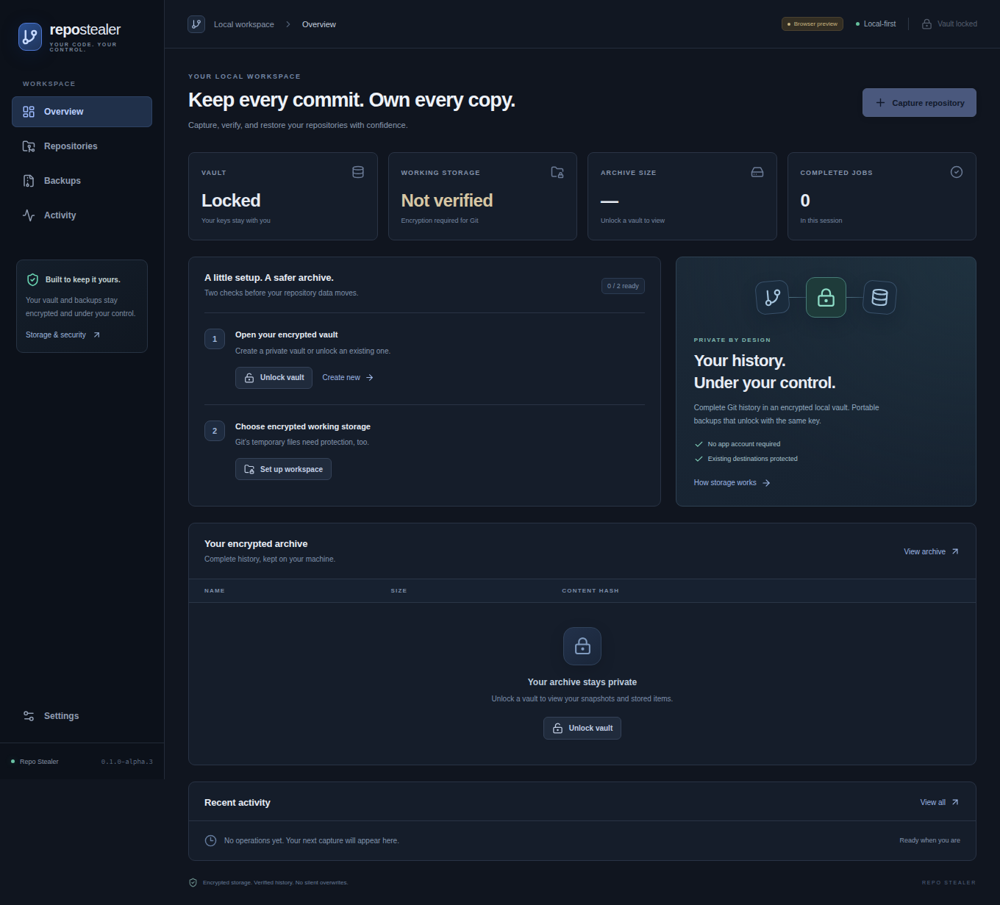

# Desktop application

The first desktop increment exposes the existing local encryption and Git engine through Tauri 2 and React. It captures local repositories and explicit HTTPS clone URLs; provider APIs and destination migration are not available yet. Native Linux and Windows workflow acceptance passed in [run 42626327189](https://github.com/hrishi072/repo-stealer/actions/runs/42626327189), including installed DEB/NSIS and extracted AppImage launch checks. RPM packaging and digest checks passed; desktop RPM installation on Fedora/openSUSE has not yet been exercised. [Alpha.3 installers](https://github.com/hrishi072/repo-stealer/releases/tag/v0.1.0-alpha.3) are published following the [successful signed-tag run](https://github.com/hrishi072/repo-stealer/actions/runs/42627291642).



## Use the application

Create a new vault or unlock an existing CLI vault using its path and passphrase. Set up a working directory on verified encrypted storage: ext4/XFS on mounted LUKS for Linux, EFS for Windows. The application cannot provision a Linux volume. Git 2.48+ must be installed and available in PATH.

Capture a local ordinary/bare repository under a unique snapshot name. Restore creates a new bare repository directly inside the verified workspace; existing destinations are never replaced. All reachable Git history, refs and HEAD are preserved. Uncommitted files, unreachable history, LFS payloads, external submodule repositories and hosting metadata are excluded. See [Git fidelity and platform requirements](GIT-SNAPSHOTS.md).

Backups can be created, verified and restored from the Backups page. Recovery requires the original vault passphrase and a new destination, and restores the same wrapped vault identity. Lock the current vault before restoring another. There is no password reset. Operations never overwrite existing backup/vault paths.

Jobs execute outside the renderer thread and show real phases, with cancellation for Git operations. A forced close has the same encrypted staging boundary as the CLI; jobs are not resumable. Activity, chosen paths and workspace selection are session-only, so reopening requires selecting them again. Lock clears catalog results and releases the vault identity; the generic session activity list remains visible, while remote origin/inventory reports are cleared. No hosting credentials, telemetry or preferences are persisted.

## Build and run

Install Rust 1.88+, Node 24, and the [Tauri platform prerequisites](https://v2.tauri.app/start/prerequisites/). Linux needs a writable tmpfs mount at `/dev/shm` for its private browser profile, plus WebKitGTK 4.1 and GTK3 development libraries; Windows needs MSVC build tools and WebView2. Platform dependencies are needed for the native shell, not the root CLI workspace.

```sh
npm --prefix apps/desktop ci
npm --prefix apps/desktop run tauri dev
```

From `apps/desktop`, run `npm run tauri build -- --bundles deb,appimage -- --locked` on Linux or `npm run tauri build -- --bundles nsis -- --locked` on Windows. Then run `python scripts/package_desktop.py` from the repository root to name release assets; Linux also requires `rpmbuild` and `desktop-file-validate`. This creates an RPM with the SemVer prerelease mapped into its Release field, avoiding Tauri’s current RPM hyphen rejection. Build output is inside `apps/desktop/src-tauri/target/release/bundle`. Desktop installers are named separately from CLI packages in releases. Windows binaries are not Authenticode signed. Only x86_64 is currently packaged.

`npm --prefix apps/desktop run dev` opens a browser design preview. Its badge identifies the preview, and native operations return an explicit desktop-required error. It never pretends to create a vault or migrate data.

## Security boundary

The renderer uses a narrow typed command interface and local bundled assets. It cannot execute arbitrary shell commands or directly access the filesystem. Native dialogs return selected paths; Rust validates paths and verifies encrypted working storage again for each Git operation. The vault identity stays in Rust. Passphrases cross local IPC transiently and are cleared from the form after submission; JavaScript cannot guarantee memory erasure. Owned passphrase inputs are zeroized in Rust even when a job is rejected before starting. Neither actions nor secrets enter job logs.

Catalog queries are paginated and bounded; status polls return summaries and up to 20 session jobs. A local CSP disallows external application content. HTTPS acquisition is isolated from the offline verifier/restore worker. Redirects, HTTP alternates and bundle-URI acquisition are refused, with TLS verification enabled. See [HTTPS capture](REMOTE-CAPTURE.md). See [security scope](SECURITY.md), including OS encryption keys, swap/dumps and mounted-volume access.

## Browser profile privacy

Windows uses incognito WebView2. Linux creates a new `0700` browser data/cache directory on verified `/dev/shm` tmpfs for every launch and removes it on normal exit. It refuses an ordinary disk fallback. This profile is separate from verified encrypted Git working storage; Git objects and credential stores never use it. tmpfs/process memory can be swapped or included in OS dumps, so the existing OS swap/dump policy still applies. A forced termination can leave an owner-only tmpfs profile until cleanup/reboot. CLI-only operations do not require this browser profile.

Wry’s WebKitGTK incognito path replaces its automation-enabled context, preventing native WebDriver sessions. The Linux RAM-backed context preserves session privacy while allowing the actual release configuration to be tested; no CI-only privacy bypass is used.
